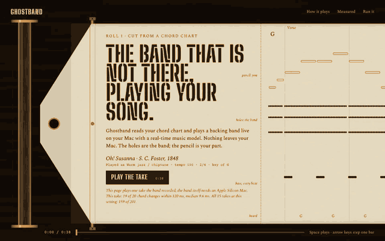

# Ghostband

You have the chords. Hear them with a band.

Ghostband is an experimental backing band that plays from a chord chart on an Apple Silicon Mac.

<picture>
  <source media="(prefers-reduced-motion: reduce)" srcset="docs/screenshots/demo-still.png" />
  
</picture>

This is a recorded take. The band still misses its timing targets, and there is no downloadable engine release for live playback yet. Start by listening to the recording below.

## Hear the recording

With Python 3.12, uv and Node installed:

```sh
git clone https://github.com/intesarjawad/ghostband.git
cd ghostband
make setup && npm --prefix ui run dev
```

Open the local address Vite prints, followed by `/demo.html`, and press Play. You hear a recorded take of the public-domain tune Oh! Susanna, not a live session. The roll shows the chart, the chords detected in the recording, and how far each chord change landed from where the chart puts it.

## What works, and what does not

**Works today**

- The recorded take and its player-piano roll.
- `make demo`: the full interface with a stand-in engine. It makes no live audio.
- Importing audio, MIDI, a chart or an iReal Pro link, and exporting a chart or MIDI.
- The measurement scripts behind every number in [the benchmark reports](docs/benchmarks/).

**Does not work yet**

- **Staying in time.** A real-time music model follows your chart, and none of its presets meets the sync threshold. The reports show each one failing.
- **Live playback from a fresh checkout.** The engine binary is a release asset, and no release is published. The Homebrew formula in `packaging/homebrew/` targets that release too.
- **Engine timings.** They are unpublished. [The engine report](docs/benchmarks/engine.md) says how to measure them on a supported Mac.

## Play a chart

The live engine needs Apple Silicon, macOS, the engine binary and model weights. From a checkout:

```sh
npm --prefix ui run build
uv run ghostband
```

The first run starts setup for the engine, the models and the extraction environment. `uv run ghostband doctor` shows what is missing, and `uv run ghostband --help` lists the commands.

Use recordings you have the right to use. `ghostband export --share` removes the melody unless the chart's rights permit sharing it.

## Limits

- Ghostband produces an instrumental mix, not separate stems.
- The engine is not notarised.
- Model weights and evaluation data are not included. SheetSage2 and MERT-v2 weights are non-commercial; the default extractor is permissive and uses a separate environment.
- The recorded demo is an archived diagnostic with unknown capture metadata. It is not acceptance evidence, and it promises nothing about other songs or settings.

## Development

`make check` runs formatting, lint, type checks and tests. The engine build needs full Xcode and CMake: see [CONTRIBUTING.md](CONTRIBUTING.md) and [the architecture](docs/architecture.md). The code is under [Apache 2.0](LICENSE); model and data licences are separate, and [NOTICE](NOTICE) carries the attributions.
