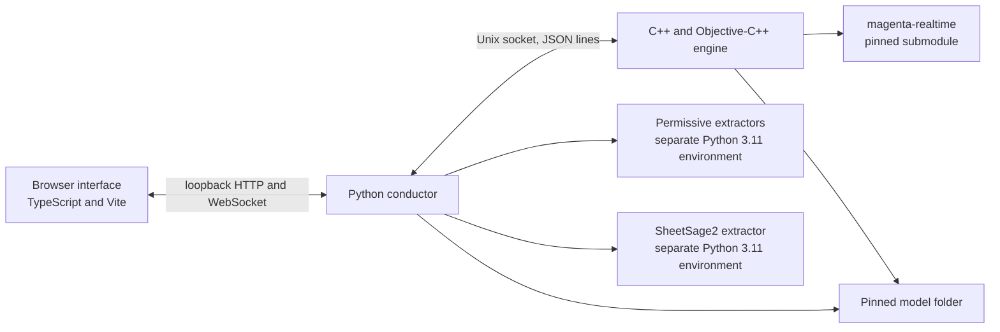

# Architecture

Ghostband is a local accompaniment tool for Apple Silicon Macs. A native engine
renders audio and runs the model. A Python conductor owns the chart, the session
and the files. A TypeScript interface in the browser controls the session.
Extraction runs in separate Python environments because the extractors need
incompatible dependencies and licences.

## Boundaries

- **Conductor to engine.** `ghostband-engine` listens on a Unix stream socket in
  a user-owned directory with mode `0700` and exchanges newline-delimited JSON.
  The conductor speaks it through `conductor/ghostband/engine_client.py`; the
  command types and validation live in `engine/src/protocol.{h,cpp}`. The
  transport, its limits and the single-controller rule are recorded in
  [ADR 0002](adr/0002-engine-socket-json-lines.md).
- **Browser to conductor.** The conductor serves the built interface and its API
  on loopback only, guarded by a per-run token. `conductor/ghostband/server.py`
  holds the policy and `conductor/ghostband/cli.py` binds `127.0.0.1:7777`; the
  reasons are in [ADR 0007](adr/0007-loopback-server-token.md).
- **Conductor to extractors.** `conductor/ghostband/importing.py` runs the
  pinned projects under `extract/` as subprocesses. Their environments are
  independent of the root environment and of each other.
  [ADR 0004](adr/0004-permissive-default-sheetsage2-offer.md) covers the default
  extractor and [ADR 0013](adr/0013-sheetsage2-parent-cache.md) the SheetSage2
  revision requirement.
- **Conductor to the audio clock.** Musical position belongs to the chart in
  beats; scheduling converts beats to seconds and follows the engine's reported
  sample positions. The chart format and scheduler contract are in
  [ADR 0003](adr/0003-chart-beats-and-scheduler-clock.md).

## Conductor modules

| Module | Responsibility |
| --- | --- |
| `chart.py` | The validated chart model every importer writes and the scheduler plays |
| `scheduler.py`, `session.py` | Beat-to-time scheduling, transport and one engine connection |
| `engine_client.py` | Bounded JSON-lines transport to the engine socket |
| `engine_process.py` | Starts the engine when none listens, reuses one that does, stops what it started |
| `server.py`, `cli.py` | Loopback interface and the `ghostband` command line |
| `importing.py`, `ireal.py`, `extractors/` | Input validation, chart conversion and extractor subprocesses |
| `export.py`, `render.py` | MIDI, bundle and iReal Pro exports; offline studio render |
| `loudness.py`, `heard.py` | Reference loudness matching and the chord row named from the engine tap |
| `style.py`, `presets.py` | Style blend smoothing and bundled or user presets |
| `first_run.py`, `setup_models.py`, `doctor.py` | Install, pinned model checksums and local prerequisites |
| `bench.py`, `evaluation/` | Live frame-time benchmark and extraction evaluation reports |

## Engine sources

`engine/src/protocol.cpp` parses and serialises the control protocol.
`session.cpp` owns the socket and command dispatch. `audio_output.mm` runs
AVFoundation and the real-time render callback. `reference_player.cpp`,
`metronome.cpp` and `audio_tap.cpp` supply the reference track, the click and the
output tap. `recording.cpp` and `wav_writer.cpp` write takes; `bench.cpp` and
`bench.mm` measure frame time. `main.mm` selects live or offline rendering.
Engine code is built with CMake 3.27.9 for macOS 14 and later, and links the
vendored magenta-realtime submodule pinned by this repository
([ADR 0010](adr/0010-vendor-magenta-realtime.md)). The sanitizer boundary is in
[ADR 0011](adr/0011-realtime-sanitizer-scope.md).

## Engine protocol

<!-- protocol-doc:start -->

This section is generated from `engine/src/protocol.cpp` by
`scripts/gen_protocol_doc.py`; edit the parser, not the table.

The engine speaks protocol version 1. Each control message is one JSON object
on a single line, at most 65536 bytes, and `cmd` names the command.

| Command | Fields |
| --- | --- |
| `hello` | none |
| `load` | `model`, `resources` |
| `play` | none |
| `stop` | none |
| `prompt` | `slot`, `text`, `weight` |
| `prompt_audio` | `slot`, `path` |
| `style_embedding` | `slot`, `values` |
| `blend` | `weights` |
| `noteon` | `pitch` |
| `noteoff` | `pitch` |
| `drumless` | `on` |
| `onset_mode` | `mode` |
| `params` | `temperature`?, `topk`?, `cfg_musiccoca`?, `cfg_notes`?, `cfg_drums`?, `buffer_frames`? |
| `click_at` | `sample`, `accent` |
| `ref_load` | `path` |
| `ref_play` | `at_sample`, `from_sample` |
| `ref_mix` | `band_gain`, `ref_gain` |
| `record` | `action`, `path`? |
| `tap` | `on` |
| `bench` | `seconds`, `latency_probes` |
| `quit` | none |

Fields are the JSON keys the parser reads before dispatch; a trailing `?` marks a
key that some valid commands omit.

The engine answers `hello` with `ok`, `protocol`, `version` and `upstream`, and failures
carry `ok` and `error`.

The engine serves one client at a time. A client that connects while another holds it
gets one reply with `ok`, `error`, `holder_pid` and `held_since`, naming the holder's process
and the Unix time it connected, and is then disconnected.

Status events carry `event`, `played_samples`, `ms_per_frame`, `underruns`, `latency_samples`, `prompt_status`, `recording`, `recorded_samples` and `tap_dropped`.

<!-- protocol-doc:end -->

## Environments and packaging

The root Python environment uses Python 3.12. The two extraction environments
use Python 3.11 and isolate incompatible dependencies and model licence
requirements. The official model-download tool has its own Python 3.12
environment. All Python locks resolve only for macOS arm64.

The UI build writes into `conductor/ghostband/ui_dist` for packaging. Generated
UI output, model files and local build directories are ignored by Git. The
submodule version changes only through an architecture decision record. The
release wheel ships the conductor, the built interface and both extractor
lockfiles; the Homebrew formula in `packaging/homebrew/` installs the engine
archive and runs that wheel through `uv tool`.

## Decision records

Numbers are permanent and unused numbers are not reused. Each record states the
alternatives that were rejected and the evidence that is still missing.

| Record | Decision |
| --- | --- |
| [0001](adr/0001-project-stack.md) | Separate the engine, conductor and browser interface |
| [0002](adr/0002-engine-socket-json-lines.md) | Control the engine over a Unix socket with JSON lines |
| [0003](adr/0003-chart-beats-and-scheduler-clock.md) | Count the chart in beats and schedule from an injected clock |
| [0004](adr/0004-permissive-default-sheetsage2-offer.md) | Default to the permissive extractor and offer SheetSage2 only on a measured gain |
| [0005](adr/0005-heard-chord-row.md) | Name the played chord from the engine tap, not from the chart |
| [0007](adr/0007-loopback-server-token.md) | Keep the browser boundary on loopback with a per-run token |
| [0008](adr/0008-upstream-recorder.md) | Use the upstream recorder with its five-minute cap |
| [0009](adr/0009-reference-loudness-match.md) | Match the reference recording to the band with BS.1770 loudness |
| [0010](adr/0010-vendor-magenta-realtime.md) | Vendor the pinned Magenta RealTime engine |
| [0011](adr/0011-realtime-sanitizer-scope.md) | Keep real-time sanitizer coverage explicit |
| [0012](adr/0012-default-model-set-fallback.md) | Use the full MRT model set until the slim set is proven |
| [0013](adr/0013-sheetsage2-parent-cache.md) | Cache the parent revision required by pinned SheetSage2 |
